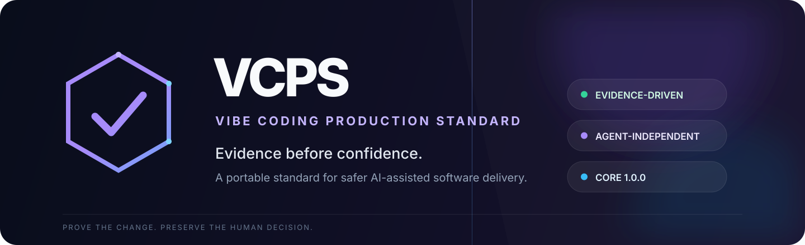
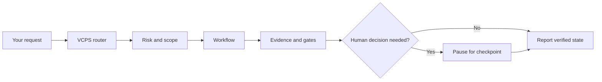

<div align="center">
  

  <p><strong>Production discipline for AI-assisted software development.</strong></p>

  <p>
    <a href="https://github.com/ChosenOneDevv/VCPS/releases"></a>
    <a href="https://github.com/ChosenOneDevv/VCPS/blob/main/LICENSE"></a>
    <a href="https://github.com/ChosenOneDevv/VCPS/actions"></a>
    <a href="https://github.com/ChosenOneDevv/VCPS/stargazers"></a>
  </p>

  <p><a href="#quick-install">Install</a> · <a href="#how-it-works">How it works</a> · <a href="#adapters">Adapters</a> · <a href="QUICKSTART.md">Quick start</a> · <a href="SECURITY.md">Security</a></p>
</div>

---

## Make “done” mean proven

AI can write code quickly. VCPS gives teams a portable way to decide whether that code is **safe, verified, and ready to ship**.

VCPS is an agent-independent standard built around evidence, risk, independent review, and explicit human decisions. It works for new projects and established codebases.

> **Evidence beats confidence.** `NOT_RUN` is never `PASS`. Missing evidence is a gap to report, not permission to guess.

## Quick install

Run from the project you want Codex to work in. This downloads VCPS from GitHub and installs the full skill set into that project:

```bash
curl -fsSL https://raw.githubusercontent.com/ChosenOneDevv/VCPS/main/install.sh | bash -s -- --adapter codex --target "$PWD"
```

Then invoke the router in Codex with **`$vcps`**. Start setup directly with **`$vcps-setup`**.

For Claude Code, use:

```bash
curl -fsSL https://raw.githubusercontent.com/ChosenOneDevv/VCPS/main/install.sh | bash -s -- --adapter claude-code --target "$PWD" --mode copy --vendor-core
```

To make Codex skills available across all projects for your OS user, add `--global` and omit `--target`:

```bash
curl -fsSL https://raw.githubusercontent.com/ChosenOneDevv/VCPS/main/install.sh | bash -s -- --adapter codex --global
```

Install script supports `--plan` to preview and `--verify` to check an installation. It refuses to overwrite existing skill paths. For source inspection, installer options, prerequisites, and limitations, see [Quick Start](QUICKSTART.md).

## How it works



| Layer | What it provides |
|---|---|
| **Core** | Normative rules, risk model, evidence tiers, lifecycle, and six gates |
| **Workflows** | SETUP, FEATURE, REVIEW, BUG, TINY, HOTFIX, AUDIT, and RELEASE procedures |
| **Templates** | Project state, work items, evidence, decisions, handoffs, and JSON Schemas |
| **Adapters** | Skills that connect the standard to Claude Code and Codex |
| **Evaluation** | Structural checks, simulations, and bounded live acceptance evidence |

Agents can execute procedures and report evidence. They cannot invent a human approval, claim an unrun check passed, or certify their own independence.

## Adapters

| Agent | Install | Invoke router | Start setup |
|---|---|---|---|
| **Codex** | `install.sh --adapter codex --target "$PWD"` | `$vcps` | `$vcps-setup` |
| **Claude Code** | `install.sh --adapter claude-code --target "$PWD" --mode copy --vendor-core` | `/vcps` | `/vcps-setup` |

Core is stable at **1.0.0**. Adapters remain reference implementations with different levels of live evidence; read the [completion roadmap](evaluation/completion-roadmap.md) before relying on a specific workflow in production. The Codex adapter's skills are structurally tested, but full live skill-loading and workflow acceptance are not yet established.

## Project principles

- `NOT_RUN` never means `PASS`.
- Evidence records what happened; confidence does not replace it.
- Risk determines required checks and independent review.
- Agents stop at human checkpoints and report the decision needed.
- Verification, acceptance, and release approval remain separate states.
- Project records stay portable across supported agents.

## Repository map

```text
standard/       Core rules, models, and gates
workflows/      Eight intent-driven procedures
templates/      Artifact contract, schemas, and worked example
adapters/       Claude Code and Codex reference skills
evaluation/     Validator, acceptance records, and test scenarios
```

## Status and limitations

VCPS is an independent project. It is **not** an official standard and is not endorsed by OpenAI, Anthropic, or another AI vendor. A VCPS conformance claim applies to a project's own evidence; this repository does not issue certification.

The Core specification is stable. Adapter and evaluation maturity is tracked separately. Live workflow evidence is bounded; CI does not establish live adapter or production behavior; the artifact validator covers a documented subset of the full contract. See [known gaps](evaluation/completion-roadmap.md), [security scope](SECURITY.md), and [version policy](standard/versioning.md).

## Contributing

Start with [CONTRIBUTING.md](CONTRIBUTING.md) and keep agent-specific behavior inside `adapters/`. Report security issues using [SECURITY.md](SECURITY.md).

<div align="center">
  <sub>Apache-2.0 · Built for honest evidence, safer changes, and clearer releases.</sub>
</div>
